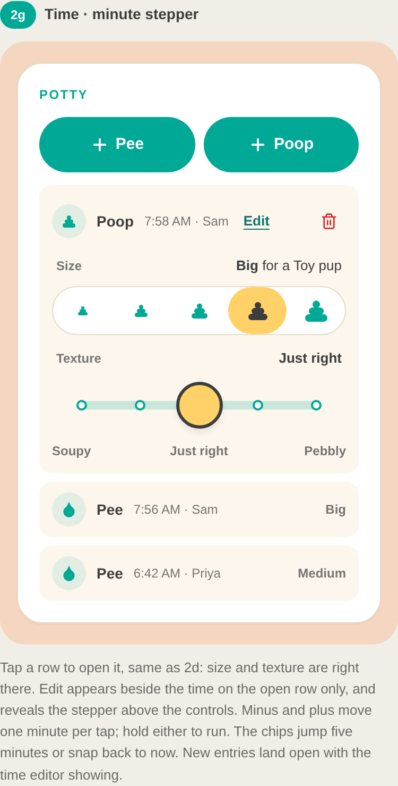
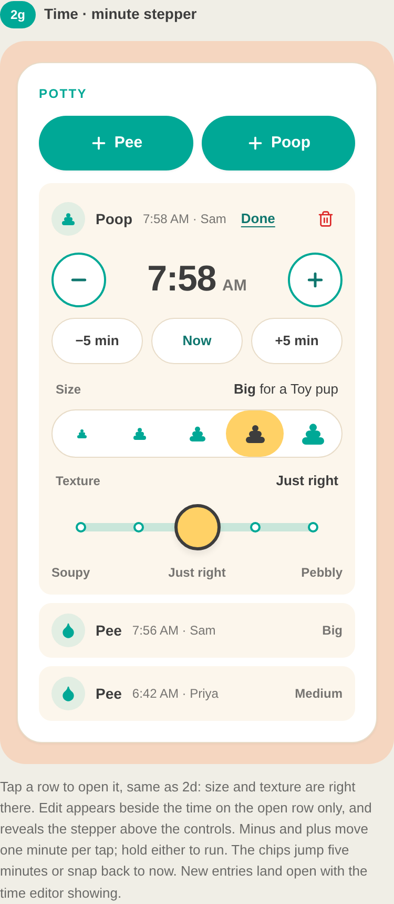
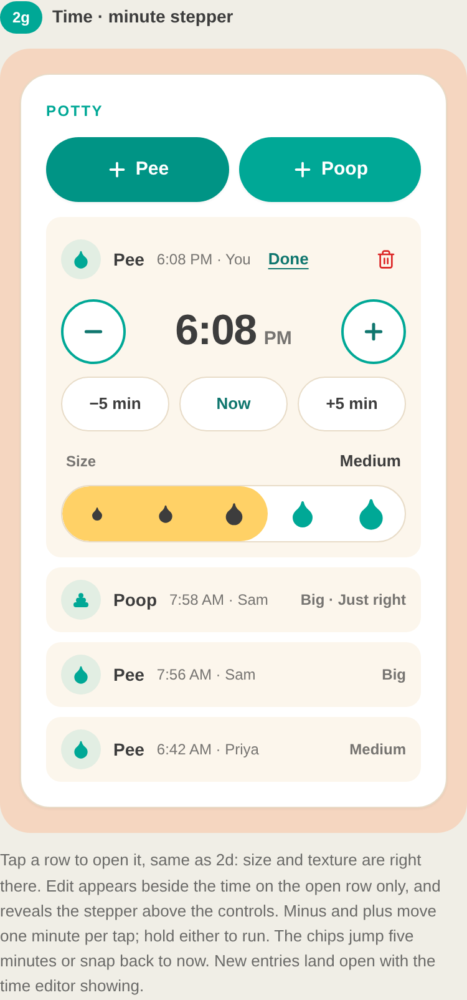

# Potty Tracking — Design Handoff

**Source:** Claude Design board "Potty Tracking v2" (design pass 2), frames 2a–2f, exported 2026-10-01
**For:** PR 3 (Settings) and PR 4 (dashboard section and controls)
**Added 2026-11-12:** frame 2g, the edit-time control, for the edit-time PR on `feature/edit-time-on-potty-tracking`. See [Edit time (frame 2g)](#edit-time-frame-2g).
**Parent spec:** [`specs/potty-tracking.md`](./potty-tracking.md)

Everything here is read from the board's markup, not estimated from screenshots. Where the board is silent, the gap is marked **Not in design** and a proposal is given for sign-off. Build nothing marked **Proposal** until it is approved.

---

## Overview

A Potty section on the dashboard, below Meds and above the Settings button. Two add buttons log a pee or a poop in one tap. Each event is a row; the newest row is open and shows its controls, older rows collapse to a one-line summary. A Settings toggle turns the feature on per pet and captures the dog's size class.

Three new controls: a pee **fill bar**, a poop **single-select scale** with a dog-relative readout, and a **detent slider** for texture. All three live inside an open event row.

## Layout

Mobile only. The app is a `max-w-md` single column; every frame is drawn at 375px. No breakpoint changes. Every control width is fractional (`flex-1`), so the controls stretch with the card.

At 375px the five marks of each scale are about 55px wide by 44px tall, which clears the 44px touch-target minimum. That closes the open "5 marks inside `max-w-md`" question.

## Design tokens used

Existing tokens only. No new colors.

| Token / class | Value | Usage |
|---|---|---|
| `bg-goofy-teal` | #00A896 | Add buttons, unselected marks, slider fill and dots, switch on, selected size pill |
| `hover:bg-[#009183]` | #009183 | Add button hover |
| `bg-goofy-yellow` | #FFD166 | Pee fill, selected poop mark, slider thumb |
| `bg-goofy-cream` | #FCF6EC | Event row background |
| `text-foreground` | #3D3D3D | Selected glyphs, thumb border, titles |
| `text-foreground/60` | — | Row meta, readout labels, count, slider end labels, Settings notes |
| `text-foreground/70` | — | Collapsed summary, empty-state copy |
| `bg-goofy-teal/10` | — | Event icon bubble |
| `bg-goofy-teal/20` | — | Slider track |
| `border-[#E8DCC8]` | #E8DCC8 | Section card border, scale container border, Settings divider |
| `bg-goofy-yellow/15` | — | Empty state |
| `text-red-400 hover:text-red-600` | #F87171 / #DC2626 | Delete icon (matches Settings page delete) |
| `rounded-3xl` | 24px | Section card |
| `rounded-2xl` | 16px | Empty state |
| `rounded-xl` | 12px | Event row |
| `rounded-full` | — | Buttons, scale containers, marks, thumb, pills, switch |

**Type sizes off the scale.** The board uses 13px for readout values and 15px for add-button labels. The design system only uses the Tailwind scale. Use `text-sm` for both. The difference is 1–2px and keeps the system clean.

**Font.** The board renders in Plus Jakarta Sans. The app uses Geist. Build in Geist; do not add a font.

## Components

New components, all in `src/components/`. Document each back into `docs/design-system/README.md` in PR 4.

| Component | Props | Notes |
|---|---|---|
| `PottySection` | none (reads `PetStoreContext`) | Renders only when `settings.potty_tracking_enabled` and `pet.size_class` are set |
| `PottyEventRow` | `event`, `open`, `onToggle`, `sizeClass` | Open or collapsed; owns no persistent state |
| `FillScale` | `value: 1..5`, `onChange`, `labels: string[]`, `icon` | Pee size. Fill grows to the selected mark |
| `SelectScale` | `value: 1..5`, `onChange`, `labels: string[]`, `icon` | Poop size. One mark highlighted |
| `DetentSlider` | `value: 1..5`, `onChange`, `labels: string[]`, `endLabels: [string, string, string]` | Texture. Fill grows out from the center stop |
| `TimeStepper` | `value: Date`, `onChange(next: Date)`, `min: Date`, `max: Date`, `showNow: boolean` | Edit time. Added 2026-11-12; see "Edit time (frame 2g)". Knows nothing about events or the store |

`FillScale` and `SelectScale` share a container and mark spec. Build them as one component with a `mode: 'fill' \| 'select'` prop if that is cleaner. The reactivity log on the roadmap will reuse the scale.

### Words

| Value | Size word | Texture word |
|---|---|---|
| 1 | Tiny | Soupy |
| 2 | Small | Squishy |
| 3 | Medium | Just right |
| 4 | Big | Crumbly |
| 5 | Huge | Pebbly |

Texture 1 = loosest and 5 = firmest, which matches `consistency` in the data model. No translation layer is needed. The data field stays `consistency`; "Texture" is UI copy only.

Size class labels: Toy, Small, Medium, Large, Giant, stored as `toy` … `giant`.

## Section (frame 2d)

Card: `bg-white rounded-3xl p-5 shadow-sm border border-[#E8DCC8] flex flex-col gap-3`.

**Header.** `flex items-baseline justify-between`.
- Left: section label "Potty", standard section-label classes (`text-xs font-extrabold tracking-widest uppercase text-goofy-teal`) with no bottom margin.
- Right: count, `text-xs font-semibold text-foreground/60`. Format `{n} pee|pees · {m} poop|poops`, singular at 1, for example "2 pees · 1 poop" or "1 pee · 0 poops". Empty string when there are no events.

**Add buttons.** `grid grid-cols-2 gap-2`. Each: `h-[52px] rounded-full bg-goofy-teal text-white text-sm font-bold flex items-center justify-center gap-1.5 shadow-sm hover:bg-[#009183]`. Plus icon 18px, stroke 2.5. Labels "Pee" and "Poop". Always visible, including when empty. That closes "does the section collapse when empty": it doesn't.

**Empty state (frame 2e).** Shown below the add buttons when no event exists for `viewDate`. `bg-goofy-yellow/15 rounded-2xl py-4 px-3 text-center`, copy `text-sm font-medium text-foreground/70`: "No potty breaks yet today. Sniff around! 🐾".

**List.** `flex flex-col gap-2`, sorted by `occurred_at` descending. The section sorts explicitly and does not rely on the context array's order, so F9 does not block PR 4.

## Event row (frame 2d)

Row: `bg-goofy-cream rounded-xl flex flex-col gap-2.5`. Padding: `p-3` open, `py-1 px-3` collapsed.

**Row header.** One `<button>` filling the row width, `min-h-11 flex items-center gap-2.5 text-left`:
- Icon bubble: 32px (`w-8 h-8`), `rounded-full bg-goofy-teal/10 text-goofy-teal`, 16px glyph (droplet for pee, stacked mound for poop; SVG paths are in the board).
- Title: `text-sm font-semibold`, "Pee" or "Poop".
- Meta: `text-xs text-foreground/60 whitespace-nowrap`, "{time}" only. Time format `h:mm AM` (`toLocaleTimeString('en-US', { hour: 'numeric', minute: '2-digit' })`). **The board shows "7:56 AM · Sam"; v1 drops the name** because profiles have no display names. Build the meta as the time alone.
- Collapsed only, pushed right with `ml-auto`: summary, `text-xs font-semibold text-foreground/70 truncate`. Pee: size word ("Big"). Poop: "{size word} · {texture word}" ("Big · Just right").

**Delete.** Open row only, at the right of the header. 44×44 hit area pulled into the padding (`-m-1.5`), 16px trash icon, `text-red-400 hover:text-red-600`. Tap removes the row with no confirmation, per the spec's mis-tap story.

**Open-row body.** Readout line, then control. Readout line: `flex items-baseline justify-between px-1`; label `text-xs font-semibold text-foreground/60`; value `text-sm font-bold`.

### Pee size — FillScale (frame 2a)

- Readout: "Size" / size word.
- Container: `relative flex bg-white border border-[#E8DCC8] rounded-full overflow-hidden`.
- Fill: absolutely positioned from the left, full height, `bg-goofy-yellow rounded-full`, width `value × 20%`. The rounded right end lands under the selected droplet.
- Marks: five buttons, `flex-1 h-11`. Droplet sizes 12, 16, 20, 24, 28px for values 1–5. Marks at or below the value are `text-foreground` (on yellow); marks above are `text-goofy-teal`.

### Poop size — SelectScale (frame 2b)

- Readout: "Size" / "**{size word}** for a {Size class} pup", for example "**Big** for a Toy pup". Only the size word is bold.
- Container: same as FillScale, without the fill.
- Marks: five buttons, `flex-1 h-11 rounded-full`. Mound sizes 12–28px as above. Selected: `bg-goofy-yellow text-foreground`. Others: transparent, `text-goofy-teal`.

### Texture — DetentSlider (frame 2c)

- Readout: "Texture" / texture word. Readout sits `mt-0.5` below the poop scale.
- Box: `relative h-12`.
- Stops at 10%, 30%, 50%, 70%, 90% of the width.
- Track: `left-[10%] right-[10%] top-5 h-2 rounded-full bg-goofy-teal/20`.
- Fill: `top-5 h-2 rounded-full bg-goofy-teal`, from the center stop to the selected stop. Left = `min(50, pos)%`, width = `|pos − 50|%`, where `pos = 10 + 20 × (value − 1)`. Zero width at "Just right".
- Stop dots: white, `border-2 border-goofy-teal`, centered on each stop. Center dot 16px at `top-4`; others 10px at `top-[19px]`.
- Thumb: 44px circle, `bg-goofy-yellow border-[3px] border-foreground shadow-md`, centered on the selected stop, `top-0.5`, `pointer-events-none`.
- Hit area: five equal transparent zones covering the whole box. Tapping a zone snaps to its stop. There is no drag in the design; see Gestures.
- End labels under the box: `grid grid-cols-3 text-xs font-semibold text-foreground/60`: "Soupy" (left), "Just right" (center), "Pebbly" (right).

## Edit time (frame 2g)

**Added 2026-11-12.** Closes the open question "does the edit-time UI ship in v1?": it does, as a minute stepper inside the open row.

**References.**
- Live board, frame 2g "Time · minute stepper": open [`docs/design/potty-tracking-v2-edit-time/index.html`](../docs/design/potty-tracking-v2-edit-time/index.html) in a browser and scroll to the "Time editor" heading. It loads React from unpkg, so it needs a network connection. The older single-file snapshot, `docs/design/potty-tracking-v2.html`, stops at frame 2f and does not contain this control.
- Screenshots, in `docs/design/img/potty-edit-time/`:

| Open row, before Edit | Editor showing | New entry |
|---|---|---|
|  |  |  |

**Frame 2h (digit wheels) is a rejected alternative. Do not build it.** It stays on the board for the record. The stepper was chosen because almost every correction is "I logged this a few minutes late", it adds about 110px to the open row against about 190px for the wheels, and it is plain buttons.

**Where the board differs from the build.** The board is a prototype; these are not instructions:
- The board's meta reads "7:58 AM · Sam". The build shows the time only, as in the rest of this handoff.
- The board's delete icon is a darker red. Keep `text-red-400 hover:text-red-600`.
- The board renders in Plus Jakarta Sans. Build in Geist.
- The board's stepper wraps past midnight and has no upper limit. The build does neither; see proposals P1 and P2.
- The board changes the time on every tick and never re-sorts. The build follows P3.

### Edit button

Open row only, and never on a failed row. It sits in the row header immediately after the time, before delete.

- The header toggle button is `flex-1` today. When the row is open it becomes `flex-none` (keep `min-w-0`), so Edit sits beside the time and not at the far right. Collapsed rows are unchanged.
- Delete moves to the right edge: replace `-m-1.5` with `-my-1.5 -mr-1.5 ml-auto` on the open row.
- Edit: `shrink-0 min-h-11 px-2 text-sm font-bold text-teal-700 underline underline-offset-[3px] cursor-pointer`. Text only, no icon; an icon does not fit at 375px beside delete. `text-teal-700` is the darker teal the dashboard's date chevrons already use; it passes 4.5:1 on cream, which `text-goofy-teal` does not.
- Label "Edit" while the stepper is hidden, "Done" while it shows. `aria-expanded` follows the stepper. `aria-label`: "Edit time for Pee at 7:58 AM" / "Done editing time".

### TimeStepper

A new component, `src/components/TimeStepper.tsx`. It renders between the row header and the Size readout. Size and texture stay visible and editable below it.

Wrapper: `flex flex-col gap-2.5 pb-1`.

**Row 1.** `flex items-center justify-between gap-2`.
- Minus and plus: `motion.button`, `w-[52px] h-[52px] shrink-0 rounded-full bg-white border-2 border-goofy-teal text-teal-700 flex items-center justify-center touch-manipulation select-none`. Lucide `Minus` and `Plus`, 20px, stroke 3. `whileTap` scale 0.88 with `POTTY_SPRING`. Disabled: `opacity-40 cursor-default`, no tap animation.
- Readout, centered: `flex items-baseline gap-1.5 tabular-nums`. Time "7:58" in `text-4xl font-extrabold tracking-tight leading-none` (the board draws 34px; use the scale). "AM" / "PM" in `text-sm font-bold text-foreground/70`.

**Row 2.** `grid grid-cols-3 gap-2`. Three chips: "−5 min", "Now", "+5 min". Each `min-h-11 rounded-full bg-white border border-[#E8DCC8] text-sm font-bold cursor-pointer`. "Now" is `text-teal-700`; the other two are `text-foreground`. Disabled as above. The minus sign in "−5 min" is U+2212, not a hyphen.

### Edit-time behavior

| Action | Result |
|---|---|
| Tap Edit on the open row | The stepper appears between the header and Size. The button reads "Done". |
| Tap Done | The stepper hides. The time is saved (P3). |
| Tap minus / plus | One minute earlier / later. |
| Press and hold minus / plus | Steps once, waits 400ms, then repeats every 90ms until pointer up, leave or cancel, or until a limit is reached. |
| Tap "−5 min" / "+5 min" | Five minutes earlier / later. |
| Tap "Now" | Sets the time to the current instant. |
| Tap + Pee / + Poop | The new row opens **with the stepper already showing**. |
| Collapse the row, open another row, log a new event, change `viewDate` | The stepper hides and the time is saved (P3). |
| Change size or texture while the stepper shows | Works as today; the stepper stays. |

Stepping adds or subtracts whole minutes from the instant (`± 60_000` ms), so the seconds are preserved. Format the readout with the same call as `formatPottyTime`.

Whether the stepper is showing is local component state, like which row is open. Never persisted, never synced.

### Proposals — Not in design

The board is silent on all six. Per the rule at the top of this file, build none of them until each is approved.

- **P1. Stay inside the day.** A time is allowed only if `localDate(candidate) === event.local_date`. A control whose step would leave the day is disabled. This keeps cross-midnight edits impossible from this control, so the "acknowledge the move" UI in the parent spec is still not needed. Moving an event to another day stays out of scope.
- **P2. No future times.** When `viewDate` is today, a time is allowed only if `candidate <= now`. Plus and "+5 min" are disabled when their step would pass now.
- **P3. Save on close, not per tick.** The row holds a draft time in local state while the stepper shows. The header time and the readout show the draft. `updateEvent(id, { occurred_at })` is called once, when the stepper hides for any reason in the table above, on unmount, and when the document becomes hidden (`visibilitychange`). Nothing is written if the draft equals the stored time. One write per edit, and a held button does not issue a write every 90ms.
- **P4. The row moves when it saves.** `updateEvent` re-sorts, so the row takes its new position when the stepper closes and not while stepping. This follows from P3 and needs no extra code. If the moved row is still the open row, it stays open.
- **P5. A row that is still saving.** A just-logged row is `saveState: 'pending'` until its insert lands, and it opens with the stepper showing. If the stepper closes while the row is still pending, hold the write until the row is `'saved'`. If the row becomes `'failed'`, drop the draft; a failed row is not editable. Size and texture edits on a pending row may have the same hazard today. Report what you find; do not change that behavior in this PR.
- **P6. "Now" on past days.** When `viewDate` is not today, "Now" is not rendered and the chip row is `grid-cols-2`.

### Edit-time accessibility

- Minus / plus `aria-label`: "One minute earlier" / "One minute later". Chips are labelled by their text.
- The readout is `aria-live="polite"`, so each step is announced.
- Enter or Space on minus / plus steps once. Hold-to-repeat is pointer only.
- Disabled controls use the `disabled` attribute.
- Focus order within the open row becomes: header, Edit, delete, minus, plus, the chips, size, texture.

### Checks for the PR description

No automated tests (decision 2026-10-10). Check by hand and list the results:

1. Open a row, tap Edit, step back three minutes, tap Done. The time shows in the header, and the row is in the right place in the list after a reload.
2. Hold minus for two seconds. The time runs, then stops on release. The network tab shows one update, after Done.
3. Log a pee. The stepper is showing. Tap "−5 min", then tap another row. The pee keeps the new time after a reload.
4. On today, plus and "+5 min" are disabled at the current minute.
5. On an event shortly after midnight, minus and "−5 min" disable at 12:00 AM. The event's `local_date` is unchanged after any edit.
6. On a past day, "Now" is absent.
7. A failed row shows no Edit.
8. Keyboard: Tab reaches every control in the order above; Enter steps.
9. With reduced motion on, the press scale is off and everything still works.

## Row behavior

| Action | Result |
|---|---|
| Tap + Pee / + Poop | New row inserted at the top, open, at defaults (size 3 "Medium"; texture 3 "Just right"). Any other open row collapses. |
| Tap a collapsed row header | It opens; the previously open row collapses. |
| Tap the open row header | It collapses. No row is open. |
| Change a mark or stop | `updateEvent` immediately, optimistic, no save button. |
| Tap delete | `removeEvent`, row disappears, no row is open. |
| Change `viewDate` | No row is open. |
| Refetch (mount, `visibilitychange`) | Keep the open row open if it is still present. |

Which row is open is local component state. It is never persisted and never synced between household members.

## States and interactions

| Element | State | Behavior |
|---|---|---|
| Add button | Hover | `bg-[#009183]` |
| Add button | Pressed | Scale 0.92 |
| Scale mark | Pressed | Scale 0.8 |
| Scale mark | Selected | See FillScale / SelectScale |
| Delete icon | Hover | `text-red-600` |
| Row | `saveState: 'pending'` | Rendered as normal. No spinner. |
| Row | `saveState: 'failed'` | **Not in design.** See below. |
| Section | Loading | Nothing new; the dashboard's existing load behavior applies |

### Failed, not-saved row — Not in design

Design brief item 5 is not on the v2 board, and the board's notes don't mention it. Behavior is fixed by F14 in the test plan; only the look is missing.

**Proposal, for sign-off.** Use the app's existing error treatment (`bg-red-50 text-red-600`, as on login and signup):
- The row background becomes `bg-red-50`. The row is collapsed and cannot be opened.
- The meta text is replaced with "Didn't save", `text-xs font-semibold text-red-600`.
- In place of the summary, a "Retry" text button, `text-xs font-bold text-red-600`, with a 44px hit area. It calls `retryEvent(id)`. While the retry is in flight, the row shows as pending (normal look).
- The delete icon stays, so a failed mis-tap can be discarded. Delete on a failed row only drops it locally; there is nothing on the server.
- Size and texture are not editable until the row saves. This avoids `updateEvent` calls against a row the server doesn't have.

The alternative is a design pass for this one state. It is small enough that the proposal is probably fine, but it is your call.

## Settings (frame 2f)

New section card between Medications and Invite Partner: `bg-white rounded-3xl p-6 shadow-sm flex flex-col gap-4`. No border, matching the other Settings cards.

**Switch row.** One `<button role="switch" aria-checked>` across the full width, `min-h-11 flex items-center justify-between gap-4 text-left`.
- Title `text-lg font-bold`: "Potty Tracking".
- Description `text-sm text-foreground/60 leading-snug`: "Log pees and poops so everyone knows when {pet name} last went out."
- Switch: track 52×32 `rounded-full`, `bg-goofy-teal` on, `bg-foreground/20` off. Knob 26px white, `shadow`, 3px inset, moves 20px right when on.

**Note** under the row, `text-xs text-foreground/60`:
- On: "On for everyone in your household. Turning it off hides it; nothing gets deleted."
- Off: "Off. Turning it on shows it for everyone in your household."

**Size picker.** Shown only while the switch is on. `border-t border-[#E8DCC8] pt-4 flex flex-col gap-2`.
- Label `text-sm font-medium`: "{pet name}'s size".
- Pills: `flex flex-wrap gap-2`; each `min-h-11 px-4 rounded-full text-sm font-semibold border-2`. Selected: `bg-goofy-teal text-white border-goofy-teal`. Unselected: transparent, `text-goofy-teal border-goofy-teal/30`.
- Help `text-xs text-foreground/60`: "Poop sizes are relative to this, so "Big" means big for a {Size class} pup."

**Size not set yet — Not in design.** The board always shows a size selected. The spec requires the size before the dashboard section appears. **Proposal:** no pill selected, and the help line reads "Pick {pet name}'s size to start logging." The dashboard section renders as soon as a size is picked.

## Data implications

Two things in the design touch the data model. Neither is a schema change if you take the recommendation.

1. **Pee has no duration.** Already applied: `duration_secs` is removed from `potty_pee` in `potty-tracking.md` and `data-model.md`.
2. **"Who logged it" is data only in v1.** The board shows a name in the row meta ("7:56 AM · Sam"), but `profiles` has only `id` and `household_id`, so there is no name to show. Decision 2026-10-10: every event stores `logged_by` (`not null default auth.uid()`, filled by the database), and the UI shows the time only. Attribution display is a later feature that needs profile names; the data will already be there.

## Edge cases

- **Size class missing.** Should not occur once the Settings gate is built. If it does, the poop readout drops the suffix and shows the size word alone.
- **Long pet names.** The Settings description and size label wrap; nothing truncates.
- **Many events in a day.** Collapsed rows are 44px plus 8px gaps. 10 events is about 520px. No cap, no pagination; the dashboard scrolls.
- **Collapsed summary.** Truncates with an ellipsis. In practice the longest is "Medium · Just right", which fits at 375px.
- **Cross-midnight edit.** Not reachable from the edit-time control: proposal P1 keeps an edited time inside the event's own day. Moving an event to another day is still out of scope.
- **Feature switched off by a household member.** The section disappears on the next fetch. Events are kept.

## Gestures

Tap only. The slider has no drag in the design. Tapping a zone is enough for one-handed use and avoids drag fighting page scroll. Do not add drag in v1.

## Motion

**The board is the source of truth for feel.** Open [`docs/design/potty-tracking-v2.html`](../docs/design/potty-tracking-v2.html) in a browser. Every frame is live: tap the marks, the slider stops, the add buttons and the Settings switch, and match what you see. Where this section and the board disagree, the board wins.

The board approximates springs with `cubic-bezier(.34, 1.8, .64, 1)` over 350ms. Build them with Framer Motion's standard spring, `{ type: "spring", stiffness: 400, damping: 17 }`, per the design system. The spring values are a starting point. Tune them until the controls feel like the board, and put the final values in one shared constant rather than repeating them per component.

### In v1: control animations (all on the board)

| Element | Trigger | Animation |
|---|---|---|
| Pee fill width | Value change | Spring |
| Slider fill (left and width) | Value change | Spring |
| Slider thumb position | Value change | Spring |
| Scale mark | Press | `whileTap` scale 0.8, spring |
| Add button | Press | `whileTap` scale 0.92, spring |
| Time stepper minus / plus (added 2026-11-12) | Press | `whileTap` scale 0.88, spring |
| Selected poop mark background | Value change | 200ms color transition |
| Switch knob | Toggle | Spring; track color 200ms |
| Size pill | Select | 150ms color transitions |

### In v1: snap, no animation

The board does not animate these, so v1 does not either. They change state instantly.

- A new row appearing at the top of the list.
- A row opening or collapsing.
- A row being deleted.
- The empty state appearing or disappearing.
- The Potty section appearing when the feature is switched on.
- The time stepper appearing or hiding (added 2026-11-12).
- A row moving to its new place in the list after its time is edited (added 2026-11-12).

Do not add height transitions, `layout` animations or `AnimatePresence` for these. Keeping them as plain state changes also keeps the list simple while the failed-row behavior is built.

### Deferred: animation pass

Revisit after the feature is in use. Candidates, in order of likely value: new row slides in at the top, row open and collapse with a short height transition, deleted row collapses out. This needs its own design decision, because the board gives no reference for any of them. Not part of PRs 3 or 4.

### Reduced motion

Respect `prefers-reduced-motion`: use Framer Motion's `MotionConfig reducedMotion="user"`. This turns off the spring movement; the color transitions can stay.

### How to check it

Open the board and the running app side by side. For each row of the v1 table, the app's control must feel the same as the board's. List the interactions checked in the PR description.

## Accessibility

The board's controls are buttons whose labels say "(selected)". Build them with proper roles instead.

- **Scales (FillScale, SelectScale).** `role="radiogroup"` with `aria-label` "Pee size" or "Poop size". Each mark is `role="radio"` with `aria-checked` and `aria-label` set to the size word. Arrow keys move the selection; roving `tabIndex`.
- **Slider.** `role="slider"`, `aria-label="Texture"`, `aria-valuemin=1`, `aria-valuemax=5`, `aria-valuenow`, `aria-valuetext` set to the texture word. Left and Right arrows step, Home and End jump. The five tap zones are `aria-hidden` and `tabIndex={-1}`, so the slider is one focus stop.
- **Row header.** `aria-expanded`. Label: "Pee at 7:56 AM" or "Poop at 7:58 AM".
- **Delete.** `aria-label="Remove this entry"`.
- **Switch.** `role="switch"` with `aria-checked`, as drawn.
- **Live region.** Announce "Pee logged" or "Poop logged" on add, and "Didn't save" when a row fails.
- **Focus order.** + Pee, + Poop, then rows top to bottom; within the open row: header, delete, size, texture.
- **Color alone.** Texture is never color-only; the readout word always shows.

**Contrast.** Most low-contrast values are inherited from the existing system and are not new to this feature: teal text and white-on-teal at 3.0:1, and `text-foreground/60` small text at about 3.3–3.4:1. Two are new here and fall just short of the 3:1 non-text minimum: unselected teal marks on white (2.98:1) and the `red-400` delete icon on cream (2.57:1). The delete icon matches the existing Settings page; neither blocks v1. Worth fixing system-wide in one pass later rather than here.

## Copy

| Where | Copy |
|---|---|
| Section label | Potty |
| Add buttons | Pee · Poop |
| Empty state | No potty breaks yet today. Sniff around! 🐾 |
| Readout labels | Size · Texture |
| Poop readout | **{word}** for a {Size class} pup |
| Slider ends | Soupy · Just right · Pebbly |
| Settings title | Potty Tracking |
| Settings description | Log pees and poops so everyone knows when {pet name} last went out. |
| Note, on | On for everyone in your household. Turning it off hides it; nothing gets deleted. |
| Note, off | Off. Turning it on shows it for everyone in your household. |
| Size label | {pet name}'s size |
| Size help | Poop sizes are relative to this, so "Big" means big for a {Size class} pup. |
| Size not set (proposal) | Pick {pet name}'s size to start logging. |
| Failed row (proposal) | Didn't save · Retry |
| Edit time button (added 2026-11-12) | Edit · Done |
| Time stepper chips (added 2026-11-12) | −5 min · Now · +5 min |

The feature is named "Potty" in the UI. That closes the naming question.
